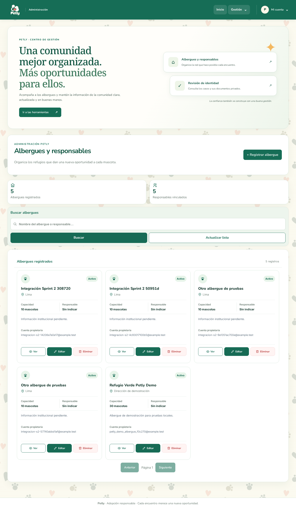
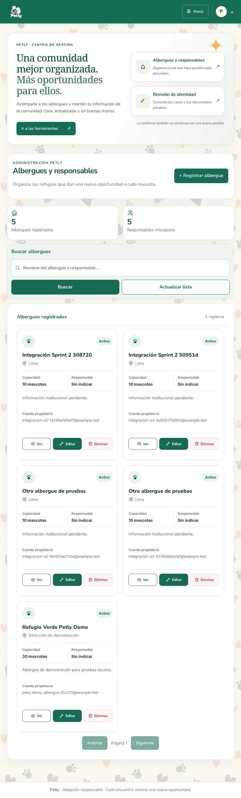
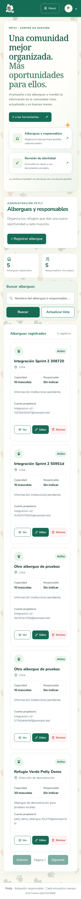

# Petly

Plataforma web y Android que facilita la **adopción responsable de mascotas**:
conecta adoptantes con albergues, orienta la búsqueda mediante compatibilidad
con el estilo de vida y organiza publicaciones, solicitudes y seguimiento.

Documento de planificación: [`PLANNING.md`](PLANNING.md) (v2).
La IA prepara descripciones revisables de mascotas; **el albergue conserva la
decisión sobre las adopciones**.

## Administración: instalación y arquitectura

El panel administrativo que usa el equipo está en React: `http://localhost:5173/administracion/albergues`. React autentica las cuentas de negocio con Spring Boot y consume Django para administrar albergues, mascotas y verificaciones KYC. El Django Admin técnico está separado en `http://localhost:8000/admin/`; usa cuentas internas de Django y no las cuentas ADMIN de Petly.

### Inicio rápido de Django

Requiere Python 3.14, MariaDB con la base `database_petly`, y Spring Boot activo para iniciar sesión desde React y consultar las cuentas de albergue. Desde PowerShell, en la raíz del repositorio:

```powershell
cd backend-admin
py -3.14 -m venv .venv
.\.venv\Scripts\Activate.ps1
pip install -r requirements.txt
Copy-Item .env.example .env
```

Completa `backend-admin/.env` con credenciales de MariaDB, `DJANGO_SECRET_KEY`, `SPRING_JWT_SECRET` e `INTERNAL_API_SECRET`. El secreto JWT debe coincidir con Spring; el secreto interno debe tener al menos 32 bytes y coincidir con el de Spring. En una base vacía, primero inicia Spring para que aplique Flyway. Luego, desde `backend-admin/`, ejecuta:

```powershell
python manage.py check
python manage.py migrate
python manage.py runserver 127.0.0.1:8000
```

En otra terminal, configura `web/.env` con `VITE_API_USUARIO_URL=http://localhost:8080` y `VITE_API_ADMINISTRACION_URL=http://localhost:8000`, y arranca React:

```powershell
cd web
npm ci
npm run dev -- --strictPort
```

Abre `http://localhost:5173`. Las migraciones de Django y Spring son independientes aunque usen la misma base. No borres ni marques migraciones como aplicadas sin revisar primero el esquema y los historiales.

### Cómo se conectan React, Django y Spring

```text
Navegador (React, 5173)
  ├─ inicio de sesión y cuentas de negocio ──> Spring Boot (8080)
  ├─ albergues, mascotas y KYC ──────────────> Django REST (8000)
  └─ reglas de compatibilidad ───────────────> Spring Boot (8080)

Django REST ── ORM / migraciones Django ──> MariaDB
Spring Boot ── Flyway ────────────────────> MariaDB
```

Spring es la autoridad de cuentas, contraseñas y JWT. React envía ese JWT como `Authorization: Bearer …` a la API que corresponda. Django valida la firma y los claims con `SPRING_JWT_SECRET`, resuelve la identidad local vinculada por `spring_id` y vuelve a aplicar permisos por rol en cada endpoint. Django no guarda la contraseña de negocio. El formulario ADMIN de React consulta en Django los albergues y cuentas disponibles; Django confirma con Spring que el responsable tenga rol ALBERGUE antes de vincularlo. La pantalla de compatibilidad de React consulta Spring directamente.

La guía completa —incluidos requisitos, configuración de variables, migraciones, rutas, arquitectura por apps y solución de problemas— está en [`backend-admin/README.md`](backend-admin/README.md).

### Imágenes del panel ADMIN React

Las capturas siguientes muestran la pantalla de **Albergues y responsables** en escritorio, tableta y móvil. Incluyen registros de demostración (`example.test`).

<details>
<summary>Ver capturas del panel</summary>
<p align="center"></p>
<p align="center"></p>
<p align="center"></p>
</details>

## Estructura del repositorio

Un solo repositorio, sin repositorios Git anidados:

| Carpeta | Componente | Stack | Puerto |
| --- | --- | --- | --- |
| `web/` | Aplicación web (áreas de adoptante, albergue y administrador) | React + TypeScript + Vite | 5173 |
| `backend-admin/` | Backend administrativo (albergues y mascotas) | Django + DRF | 8000 |
| `backend_usuario/petly_proyect/` | Backend de usuarios (cuentas, perfiles, catálogo) | Spring Boot + Java 21 + Maven | 8080 |
| `mobile_petly/` | Experiencia Android del adoptante | Kotlin + Jetpack Compose | n/a |
| `database/` | Modelo de datos y datos de demostración | MariaDB (`database_petly`) | 3306 |
| `docs/` | Arquitectura, instalación, acuerdos, API y sprints | Markdown | — |

> Las carpetas `backend_usuario/` y `mobile_petly/` son los proyectos
> preexistentes; se conservan con su nombre y paquetes originales
> (`com.petly` y `com.petly_app`). El desajuste respecto a la estructura de
> `PLANNING.md` §7 está documentado en [`docs/arquitectura.md`](docs/arquitectura.md).

## Puesta en marcha rápida (Windows)

Antes de arrancar, completar las variables privadas y revisar migraciones según [`docs/instalacion.md`](docs/instalacion.md). En una base vacía iniciar Spring/Flyway primero, después aplicar migraciones Django. Spring no carga `.env` automáticamente.

1. Arrancar MariaDB desde XAMPP (base `database_petly`).
2. Spring Boot:

   ```powershell
   cd backend_usuario\petly_proyect
   .\mvnw.cmd spring-boot:run
   ```

3. Django:

   ```powershell
   cd backend-admin
   .\.venv\Scripts\Activate.ps1   # o crearlo: py -m venv .venv
   python manage.py runserver
   ```

4. React:

   ```powershell
   cd web
   npm install
   npm run dev
   ```

5. Android Studio → abrir `mobile_petly`.

Detalle, requisitos y comprobaciones en [`docs/instalacion.md`](docs/instalacion.md).

## Endpoints de salud

| Servicio | URL | Respuesta |
| --- | --- | --- |
| Spring Boot | `GET http://localhost:8080/api/health/` | `{"status":"UP"}` |
| Django | `GET http://localhost:8000/api/health/` | `{"status":"UP"}` |

Respuesta básica, sin información sensible (versión, base de datos o rutas).

## Documentación de API (OpenAPI / Swagger UI)

| Servicio | Esquema OpenAPI | Swagger UI |
| --- | --- | --- |
| Spring Boot | `GET http://localhost:8080/v3/api-docs` | `http://localhost:8080/swagger-ui.html` |
| Django | `GET http://localhost:8000/api/schema/` | `http://localhost:8000/api/docs/` |

## Documentación

- [`PLANNING.md`](PLANNING.md) — planificación v2 (alcance, decisiones, sprints).
- [`docs/arquitectura.md`](docs/arquitectura.md) — componentes, integración y responsables de datos.
- [`docs/instalacion.md`](docs/instalacion.md) — requisitos y comandos en Windows.
- [`docs/acuerdos-equipo.md`](docs/acuerdos-equipo.md) — reparto y revisión cruzada.
- Los endpoints implementados se pueden consultar en Swagger de Spring y en la documentación OpenAPI de Django indicados arriba.
- [`docs/sprint-01.md`](docs/sprint-01.md) — alcance del Sprint 1 (**implementación y revisión**).
- [`docs/sprint-01.md`](sprint-02-descripcion-originales.md) — alcance del Sprint 2 (actualmente) (**implementación y revisión**).
- [`database/modelo-datos.md`](database/modelo-datos.md) — modelo preliminar de datos.

## Estado actual

Implementación Sprint 1 en `feature/petly_proyect` (12 de octubre de 2026):
Implementación en proceso de  Sprint 2 en main (27 de octubre de 2026):

- Perfil y convivencia Android con persistencia Spring, borrador/finalización y validaciones.
- Catálogo Spring con datos Django reales, filtros combinados, paginación, detalle, fotografía y estados.
- Spring como única autoridad de credenciales; Android consume JWT y Django lo valida.
- Recuperación por correo, token de uso único y consentimiento revocable por albergue.
- Migraciones aditivas, pruebas automatizadas y recorrido real en una base aislada; base del equipo sin modificar.
- React funcional para ADMIN, ALBERGUE y ADOPTANTE: acceso/recuperación, CRUD institucional ADMIN, gestión del albergue/mascotas y experiencia web del adoptante.
- Fotografías suministradas publicadas desde ALBERGUE y servidas por Django para React y Android.
- Las historias esperan revisión cruzada y verificación en el entorno compartido del equipo.


## Reglas del repositorio

- Sin secretos en Git: `.env` (y `local.properties`) están excluidos; solo se versionan `.env.example`.
- Sin Docker ni microservicios adicionales.
- Los commits/push se realizan cuando el usuario los solicita.

El [diccionario de datos](database/diccionario-datos.md) describe el esquema compartido. El arranque local utiliza `backend-admin/.venv/bin/python scripts/servicios-locales.py`. Los datos MariaDB están en `~/.local/share/petly/mariadb`. Consulta el [procedimiento de recuperación](database/auditoria-2026-11-14/ejecucion-retiro.md#recuperación) para el respaldo previo al retiro del chat antiguo.
