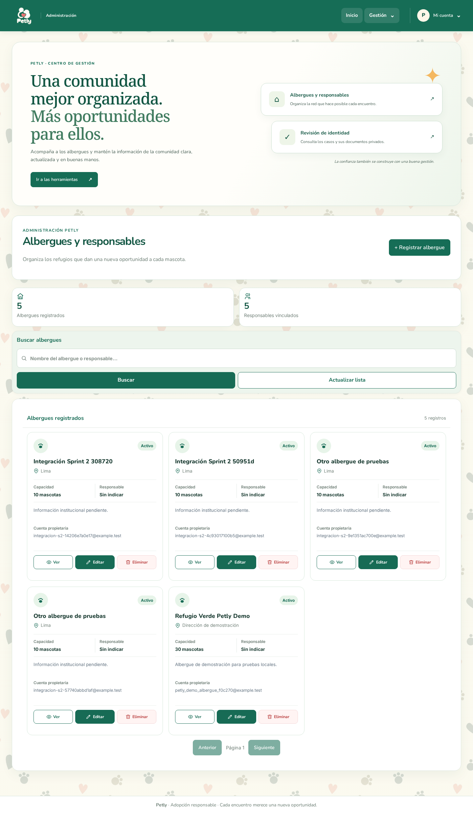
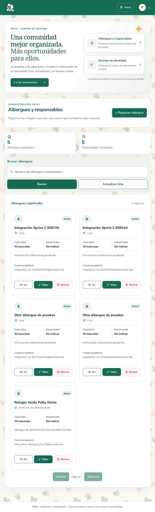
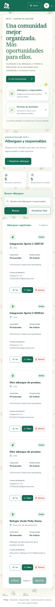

# Petly · Backend administrativo Django

Este servicio es el backend administrativo de Petly. Expone la API que consume el panel web en React y también contiene el panel HTML de albergues y el Django Admin técnico.

| Servicio | URL local | Responsabilidad |
|---|---|---|
| React / Vite | `http://localhost:5173` | Interfaz web para ADMIN, ALBERGUE y ADOPTANTE. |
| Django / DRF | `http://localhost:8000` | API administrativa, catálogo y operaciones de albergues, mascotas, KYC y contratos. |
| Spring Boot | `http://localhost:8080` | Fuente de verdad de las cuentas, autenticación de negocio y ciertas operaciones de administración. |
| MariaDB | `127.0.0.1:3306` por defecto | Persistencia compartida. Django y Spring aplican sus propias migraciones. |

> **Diferencia entre paneles:** el **panel administrativo en React** está en `/administracion/...` y utiliza cuentas ADMIN de Petly autenticadas por Spring. El **Django Admin** está en `/admin/` y utiliza cuentas técnicas `is_staff`/`is_superuser` creadas en Django. Son interfaces y credenciales distintas.

## Requisitos

- Windows 10/11 con PowerShell, macOS o Linux.
- Python **3.14.3** es la versión verificada por el equipo; los paquetes están fijados en `requirements.txt`.
- MariaDB disponible y accesible desde Django. La plantilla usa `database_petly`, host `127.0.0.1`, puerto `3306`; cambia el puerto si tu instancia usa otro (por ejemplo, `13306`).
- Spring Boot disponible en `localhost:8080` para iniciar sesión desde React, validar la integración de cuentas y usar las operaciones que dependen de Spring.
- Node.js y npm para ejecutar React (ver [web/README.md](../web/README.md) y la guía general [docs/instalacion.md](../docs/instalacion.md)).

## Instalación en Windows

Abre PowerShell en la raíz del repositorio:

```powershell
cd backend-admin
py -3.14 -m venv .venv
.\.venv\Scripts\Activate.ps1
python -m pip install --upgrade pip
pip install -r requirements.txt
Copy-Item .env.example .env
```

Si PowerShell impide activar el entorno virtual, permite scripts solo para la sesión actual y vuelve a activarlo:

```powershell
Set-ExecutionPolicy -Scope Process -ExecutionPolicy Bypass
.\.venv\Scripts\Activate.ps1
```

En macOS/Linux, desde `backend-admin/`:

```bash
python3.14 -m venv .venv
source .venv/bin/activate
python -m pip install --upgrade pip
pip install -r requirements.txt
cp .env.example .env
```

### Configurar las variables de Django

Edita `backend-admin/.env`. Django lo carga al iniciar; este archivo es local y no debe subirse a Git. Como mínimo, establece:

```dotenv
DJANGO_SECRET_KEY=clave-privada-para-django
DJANGO_DEBUG=true
DJANGO_ALLOWED_HOSTS=localhost,127.0.0.1,10.0.2.2
DJANGO_ALLOWED_ORIGINS=http://localhost:5173,http://127.0.0.1:5173
DB_NAME=database_petly
DB_HOST=127.0.0.1
DB_PORT=3306
DB_USER=root
DB_PASSWORD=
SPRING_JWT_SECRET=el-mismo-secreto-de-spring
INTERNAL_API_SECRET=el-mismo-secreto-interno-de-spring
SPRING_API_URL=http://127.0.0.1:8080
```

Genera claves aleatorias localmente en PowerShell, copia cada resultado en `.env` y comparte cada valor entre los dos servicios solo donde se indica:

```powershell
python -c "import secrets; print(secrets.token_urlsafe(48))"
```

| Variable | Uso |
|---|---|
| `DJANGO_SECRET_KEY` | Clave privada propia de Django. No se comparte ni se publica. |
| `SPRING_JWT_SECRET` | Debe coincidir exactamente con el secreto de firma JWT configurado en Spring. Django verifica con ella los tokens de negocio. |
| `INTERNAL_API_SECRET` | Debe coincidir exactamente con el secreto de servicio Spring–Django y tener al menos 32 bytes. Django no arranca si falta o es demasiado corto. |
| `DB_*` | Conexión de MariaDB. `DB_PORT` debe coincidir con el puerto real del motor. |
| `DJANGO_ALLOWED_ORIGINS` | Orígenes exactos del navegador. Incluye el host y puerto que usarás en Vite. `localhost` y `127.0.0.1` son orígenes diferentes. |
| `DJANGO_ALLOWED_HOSTS` | Hosts aceptados por Django. En desarrollo se incluye `10.0.2.2` para el emulador Android. No uses `*`. |
| `SPRING_API_URL` | Dirección de Spring usada por las llamadas internas protegidas con `INTERNAL_API_SECRET`. |
| `CONTRACT_SIGNATURE_*`, `FIRMEASY_*`, `GEMINI_*`, `PET_DESCRIPTION_*`, `US27_*` | Integraciones opcionales de firma, generación de contenido e imágenes. Configúralas solo si vas a usar esas funciones. Nunca pongas tokens reales en el README. |

La configuración de contrato puede requerir variables adicionales, como `ADOPTION_CONTRACT_TERMS`, su versión y la aprobación correspondiente. No se deben inventar términos legales: el responsable del proyecto debe proporcionarlos y aprobarlos.

### Crear y migrar la base de datos

En MariaDB, crea la base si todavía no existe y confirma que el usuario configurado tenga permisos para crear tablas e índices:

```sql
CREATE DATABASE database_petly CHARACTER SET utf8mb4 COLLATE utf8mb4_unicode_ci;
```

Usa el nombre, usuario y puerto de tu `.env`. Si la base es nueva, inicia primero Spring Boot para que Flyway cree su esquema y su historial; luego ejecuta las migraciones Django. **No borres tablas ni marques migraciones como aplicadas para resolver diferencias.** En una base existente, revisa primero su esquema y los historiales `flyway_schema_history` y `django_migrations`; sigue [la guía de instalación e integración](../docs/instalacion.md) antes de cambiarla.

Con el entorno virtual activado, desde `backend-admin/`:

```powershell
python manage.py check
python manage.py showmigrations
python manage.py migrate --plan
python manage.py migrate
```

`migrate` crea o actualiza las tablas gestionadas por Django. Las migraciones de Spring son independientes y se ejecutan con Flyway al iniciar Spring. El esquema `database_petly` es compartido, pero cada servicio es responsable de sus propias migraciones.

### Iniciar Django y verificarlo

Desde `backend-admin/`, con el entorno activo y MariaDB encendida:

```powershell
python manage.py runserver 127.0.0.1:8000
```

Verifica en otra terminal:

```powershell
Invoke-RestMethod http://127.0.0.1:8000/api/health/
```

La respuesta esperada es `status: UP`. Otros recursos útiles:

- `http://127.0.0.1:8000/api/docs/` — Swagger UI de la API.
- `http://127.0.0.1:8000/api/schema/` — esquema OpenAPI.
- `http://127.0.0.1:8000/panel/` — panel HTML de albergue con sesión Django.
- `http://127.0.0.1:8000/admin/` — Django Admin técnico.

El servidor de desarrollo no es un servidor de producción. En producción, configura `DEBUG=false`, dominios concretos, HTTPS, un servidor WSGI/ASGI, archivos estáticos/media y secretos administrados por el entorno. Revisa `python manage.py check --deploy` después de completar esa configuración.

### Cuenta para Django Admin técnico

Si necesitas usar `/admin/`, crea una cuenta técnica en Django:

```powershell
python manage.py createsuperuser
```

Esta cuenta sirve para gestionar datos mediante la interfaz estándar de Django. **No es** una cuenta ADMIN de Petly y no sirve para entrar al panel React. Las cuentas de negocio y sus contraseñas pertenecen a Spring Boot. No cambies permisos de usuarios de negocio para convertirlos en superusuarios Django.

## Arquitectura del backend Django

```text
config/
├── settings.py       Variables de entorno, apps, DB, CORS, DRF y JWT
├── urls.py           Rutas HTML, Django Admin, API y documentación
├── wsgi.py / asgi.py Puntos de entrada de despliegue
└── test_settings.py  Configuración aislada de pruebas con SQLite

apps/
├── acceso/           Identidad espejo, JWT, solicitudes, KYC y permisos
├── albergues/        Albergues, infraestructura, eventos y respuestas
├── mascotas/         Mascotas, fotos, compatibilidad y catálogo
├── contratos/        Seguimiento, documentos, firma y reportes
└── mensajeria/       Conversaciones y mensajes
```

El flujo típico de una petición REST es:

1. `config/urls.py` dirige la URL a la app correspondiente.
2. Una vista o `ViewSet` valida autenticación, rol y alcance del objeto.
3. Los serializers de Django REST Framework validan y convierten JSON/modelos.
4. Los modelos consultan o actualizan MariaDB mediante el ORM.
5. La vista devuelve JSON (o una descarga protegida) al cliente.

`config/settings.py` declara Django Admin, sesiones para las vistas HTML, Django REST Framework, CORS, el modelo de usuario `apps.acceso.User`, el motor MariaDB y la autenticación JWT. Las migraciones Django están dentro de cada app, en `apps/<app>/migrations/`.

### Qué servicio es dueño de cada dato

- **Spring Boot** es la autoridad de cuentas de negocio, contraseñas y emisión del JWT de React.
- **Django** guarda los datos operativos que administra: albergues, mascotas, infraestructura, solicitudes/seguimientos y registros KYC, entre otros modelos de sus apps.
- Django crea o actualiza una identidad local de referencia al validar el JWT. Su `spring_id` relaciona registros Django con la cuenta Spring; no replica su contraseña.
- Cuando una operación necesita confirmar una cuenta ALBERGUE, Django consulta Spring y vincula el ID validado. El servicio interno utiliza el secreto compartido; el cliente React no recibe ese secreto.
- React es el cliente de presentación. Ocultar una ruta en React no autoriza una operación: Django/Spring vuelven a comprobar token, rol y permisos en el backend.

## Conexión con el panel administrativo React

### Rutas y servicios

`web/src/routes/index.tsx` define el área `/administracion` protegida por `ProtectedRoute role="ADMIN"`. El inicio de sesión y la identidad vienen de Spring. Después, según la pantalla, React consume una o ambas APIs:

| Pantalla React | API principal | Uso |
|---|---|---|
| `/administracion/albergues` | Django `GET/POST /api/albergues/`, `PATCH/DELETE /api/albergues/{id}/` | Listar, buscar, registrar, editar, consultar y eliminar albergues. |
| Formulario de albergue | Django `GET /api/albergues/cuentas-disponibles/` y Spring `/api/admin/cuentas-albergue` | Mostrar cuentas ALBERGUE disponibles y vincular una cuenta al crear un albergue. |
| `/administracion/verificaciones-kyc` | Django `/api/acceso/verificaciones-kyc/` | Revisar los casos KYC y descargar documentos protegidos. |
| Decisión KYC | Django `POST /api/acceso/verificaciones-kyc/{id}/revision/` | Guardar aprobación/rechazo manual con motivo y responsable. |
| `/administracion/compatibilidad` | Spring `/api/admin/compatibilidad/reglas` | Consultar y guardar los pesos globales de compatibilidad. |

Los módulos React de estas pantallas están en `web/src/features/administracion/`. El cliente HTTP común está en `web/src/services/http.ts`:

- `spring(...)` construye peticiones a Spring usando `VITE_API_USUARIO_URL`.
- `django(...)` construye peticiones a Django usando `VITE_API_ADMINISTRACION_URL`.
- Ambos adjuntan el mismo JWT en `Authorization: Bearer …` desde la sesión activa en memoria.
- `downloadDjango(...)` agrega el token para descargar documentos privados.

El navegador llama directamente a los backends; React no hace de proxy. Por eso Django debe permitir mediante CORS el origen exacto de Vite y los dos backends deben estar disponibles. El JWT está en memoria: al recargar la página el usuario deberá iniciar sesión de nuevo.

### Flujo: registrar un albergue desde React

1. Una persona entra a React y Spring autentica su cuenta `ADMIN`; devuelve un JWT con el rol.
2. `ProtectedRoute` muestra el área `/administracion` solo para la sesión `ADMIN`.
3. `AlberguesAdminPage` llama a Django para cargar albergues y cuentas disponibles. Las peticiones incluyen el JWT.
4. `SpringBootJWTAuthentication` en Django verifica la firma con `SPRING_JWT_SECRET` y comprueba emisor, audiencia, expiración y tipo del token. El modelo local resuelve la identidad y su rol.
5. El `AlbergueViewSet` y su permiso vuelven a validar que el rol pueda administrar albergues.
6. Al seleccionar un responsable, Django consulta Spring para comprobar que la identidad existe y tiene rol ALBERGUE. Django rechaza cuentas ya asignadas o técnicas.
7. Django guarda los datos del albergue y su vínculo en MariaDB y devuelve la representación JSON a React.

### Capturas del panel ADMIN React

Estas capturas corresponden a la pantalla React **Albergues y responsables**. Los registros y correos `example.test` son datos de demostración. Las imágenes originales están versionadas en `web/output/redisenio/`.

<details>
<summary>Ver capturas en escritorio, tableta y móvil</summary>
<p align="center"></p>
<p align="center"></p>
<p align="center"></p>
</details>

### Configurar React

Desde la raíz del repositorio:

```powershell
cd web
Copy-Item .env.example .env
npm ci
npm run dev -- --strictPort
```

En `web/.env`, comprueba que las URLs correspondan a los servicios locales:

```dotenv
VITE_API_USUARIO_URL=http://localhost:8080
VITE_API_ADMINISTRACION_URL=http://localhost:8000
```

Abre `http://localhost:5173`. El backend Django debe incluir ese origen en `DJANGO_ALLOWED_ORIGINS`; si React se abre con `127.0.0.1` en vez de `localhost`, agrega también `http://127.0.0.1:5173`. Mantén URLs y navegador con el mismo host para evitar errores de CORS.

### Recorrido local completo

1. Inicia MariaDB y asegúrate de que la base configurada en Django y Spring sea la misma.
2. Inicia Spring Boot con el mismo `SPRING_JWT_SECRET` e `INTERNAL_API_SECRET` que usa Django.
3. Inicia Django en el puerto 8000 y confirma `/api/health/`.
4. Inicia React en el puerto 5173.
5. Inicia sesión desde React con una cuenta de negocio `ADMIN` creada en Spring. No uses el superusuario técnico de Django.
6. Abre `/administracion/albergues`, `/administracion/verificaciones-kyc` o `/administracion/compatibilidad` según la operación.

## Rutas principales de Django

| Ruta | Descripción |
|---|---|
| `/admin/` | Interfaz administrativa técnica de Django, sesión y permisos Django. |
| `/panel/` | Panel HTML de albergue basado en plantillas Django/Bootstrap. |
| `/api/albergues/` | API REST para albergues e infraestructura. |
| `/api/mascotas/` | API REST de catálogo, CRUD de mascotas y operaciones asociadas. |
| `/api/acceso/` | Autenticación/identidad integrada, solicitudes, KYC y otros recursos de acceso. |
| `/api/contratos/` | Seguimiento, contratos y recursos asociados. |
| `/api/mensajeria/` | API de conversaciones y mensajes. |
| `/api/schema/`, `/api/docs/` | OpenAPI y Swagger UI. |
| `/api/health/` | Comprobación simple de disponibilidad. |

Los endpoints pueden requerir roles distintos. Consulta las vistas, permisos y serializers antes de integrar un cliente nuevo; no asumas que todas las rutas son ADMIN.

## Comprobaciones y solución de problemas

Comandos de diagnóstico desde `backend-admin/`:

```powershell
python manage.py check
python manage.py showmigrations
python manage.py migrate --plan
python manage.py test --settings=config.test_settings
```

La configuración de pruebas usa SQLite en memoria y claves de prueba; no apunta a MariaDB de desarrollo. No cambies la base de pruebas por la base compartida para resolver un fallo.

| Síntoma | Revisión |
|---|---|
| Django informa que `INTERNAL_API_SECRET` debe tener 32 bytes | Define un valor privado de al menos 32 bytes en `backend-admin/.env`. Configura el mismo valor en Spring. |
| `Access denied` o no se puede conectar a MariaDB | Comprueba que MariaDB esté activa, y que `DB_HOST`, `DB_PORT`, `DB_NAME`, `DB_USER` y `DB_PASSWORD` correspondan a esa instancia. |
| Django devuelve 401 al consumir desde React | Comprueba que Spring esté activo, que el JWT no haya expirado y que `SPRING_JWT_SECRET` sea idéntico en Spring y Django. |
| Django devuelve 403 | Confirma que el JWT corresponde al rol necesario y que el permiso del endpoint permite esa operación. Iniciar sesión como ADMIN en React no convierte en ADMIN la sesión del Django Admin. |
| El navegador muestra error CORS | Agrega el origen exacto (protocolo, host y puerto) de Vite a `DJANGO_ALLOWED_ORIGINS` y reinicia Django. |
| Error al vincular un responsable | Comprueba que Spring esté accesible en su URL local, que la cuenta tenga rol ALBERGUE y que no esté ya asignada a otro albergue. |
| No aparecen cambios de modelos en migraciones | Revisa `python manage.py makemigrations --check --dry-run`; no edites migraciones ya aplicadas sin coordinar el esquema. |

## Archivos importantes

```text
backend-admin/
├── .env.example                 Plantilla local de variables; no contiene secretos
├── manage.py                    CLI de Django
├── requirements.txt             Versiones fijadas de Python
├── config/                      Settings, rutas y puntos de entrada
├── apps/                        Dominios funcionales y migraciones
├── templates/                   Panel HTML y plantillas de autenticación
├── static/                      CSS estático del panel
└── media/                       Archivos locales; no versionar
```

Referencias del repositorio: [guía general de instalación](../docs/instalacion.md), [guía para compañeros](../docs/guia-companeros-sprint-01.md), [documentación de API](../docs/api.md) y [.env.example de React](../web/.env.example).

## Entrega externa de cambios de estado (US-45 → US-41)

1. Inicia Spring con Flyway y aplica después las migraciones de Django en la misma base compartida. Desde `acceso.0022`, `acceso_user.usuario_spring_id` vincula la identidad local con `usuarios.id` de Spring. Desde `albergues.0009`, `albergues.propietario_django_id` referencia la cuenta local `acceso_user.id`. Los canales se leen de `preferencias_notificacion`; si aún no hay preferencias, Spring aplica los valores predeterminados.
2. Configura `FRONTEND_URL` para que apunte a la web que abrirán los destinatarios. Para recibir correo real, configura SMTP; el backend de desarrollo guarda el correo en archivos.
3. Para FCM, instala `requirements-fcm.txt` en el entorno del trabajador y configura `AVISOS_FCM_PROJECT` y las credenciales ADC autorizadas. En Android, usa `-PpetlyFirebaseAppId`, `-PpetlyFirebaseApiKey`, `-PpetlyFirebaseSenderId` y `-PpetlyFirebaseProjectId` del mismo proyecto Firebase. Registra el ID de aplicación exacto, incluido `.integration` si corresponde, y concede el permiso de notificaciones en Android 13 o posterior.
4. Para WhatsApp, configura la API `/messages` de Meta, token, idioma y plantilla aprobada con dos parámetros posicionales en el cuerpo: estado y enlace. En pruebas, habilita el número de envío de prueba y agrega el teléfono de destino autorizado. El teléfono debe incluir el prefijo internacional.
5. Ejecuta el worker de entregas aparte: `python manage.py procesar_avisos_externos --watch`. Sin `--watch`, procesa un lote y termina.

Cada `EntregaExterna` registra canal, huella del destino, intentos y resultado. `ACEPTADA` significa que el proveedor aceptó el envío; `REINTENTAR` cubre errores previos al envío o HTTP 429, hasta cinco intentos; `INCIERTA` requiere conciliación manual para evitar duplicados después de un timeout o interrupción. El worker vuelve a validar preferencias y destino. Android elimina localmente la vinculación y notificaciones al cerrar sesión y reintenta la revocación si el servidor no responde.

Para aceptar la integración, prueba dos cuentas con preferencias distintas, registra sus dispositivos y genera transiciones nuevas. Verifica email, push, WhatsApp y el caso sin canales habilitados. Luego habilita email y push para la cuenta de prueba, envía Android a segundo plano, verifica recepción y abre el enlace autenticado. Confirma que la segunda cuenta no reciba el evento ni pueda acceder a él.

## Afiches de adopción con IA

Aplica las migraciones `mascotas.0007` y `mascotas.0008`. Configura `AFICHE_WORKER_TOKEN` con el mismo secreto en Django y en el entorno del trabajador. Con Django sirviendo las fotos de mascotas y Codex CLI conectado, ejecuta `node trabajador.js` desde la raíz del repositorio; comprueba previamente la sesión con `codex login status`. El trabajador requiere Node 22 o posterior y Python con Pillow. Por defecto usa el Python del entorno Django; `AFICHE_PYTHON` permite elegir otro. `scripts/servicios-locales.py` inicia el worker cuando encuentra `AFICHE_WORKER_TOKEN` y registra actividad en `afiches.log`.

`AFICHE_DJANGO_URL` usa por defecto `http://127.0.0.1:8000`. `AFICHE_CODEX_TIMEOUT_MS` tiene valor predeterminado `180000` y `AFICHE_RESERVA_SEGUNDOS`, `600`. El worker consulta cada cinco segundos cuando está libre. Un fallo temporal admite reintento dentro de la reserva. Si el proceso se interrumpe, el pedido vuelve a estar disponible tras el vencimiento y puede reservarse hasta tres veces. Los registros JSON de cola, generación y entrega incluyen el identificador y duración por fase.

| Operación | Ruta | Respuesta |
|---|---|---|
| Crear pedido | `POST /api/mascotas/{mascota_id}/afiches/` | `201` con pedido nuevo o `200` con el pedido activo para esa foto. |
| Consultar pedido | `GET /api/mascotas/afiches/{pedido_id}/` | Estado, errores y URL del fondo al terminar. |
| Descargar fondo | `GET /api/mascotas/afiches/{pedido_id}/fondo/` | PNG privado del pedido completado. |
| Tomar pedido interno | `POST /api/mascotas/interno/afiches/tomar/` | Pedido con `foto_url`, `foto_version` y `reserva`, o `204` sin trabajo. |
| Entregar resultado interno | `POST /api/mascotas/interno/afiches/{pedido_id}/entregar/` | Estado actualizado o `409` si venció/cambió la reserva. |

Las operaciones del albergue usan su Bearer JWT. Django verifica foto, nombre y contacto público y guarda los datos validados con el pedido. Las operaciones internas requieren `X-Afiche-Worker-Token`. En la entrega el worker envía `reserva`, `estado` y, para un resultado exitoso, el archivo `fondo` como multipart. Si falla, incluye `error_codigo` y marca `reintentar=false` cuando agota su reintento local. Django almacena el fondo bajo `PRIVATE_FILES_ROOT`; el navegador genera el PNG final de 1080 × 1350 con Canvas. Al recargar, el flujo retoma el pedido tras iniciar sesión de nuevo.
